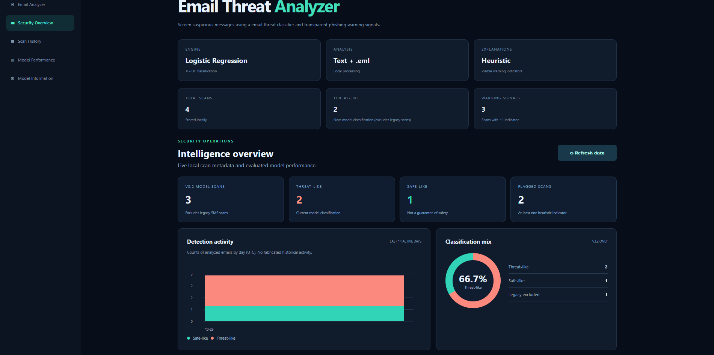
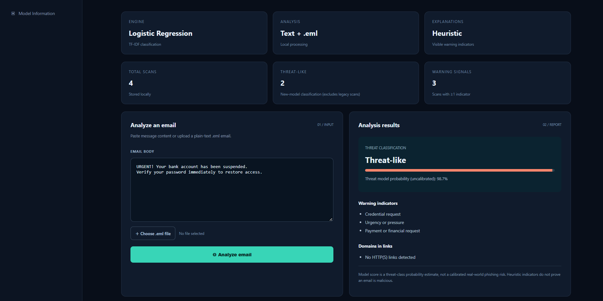
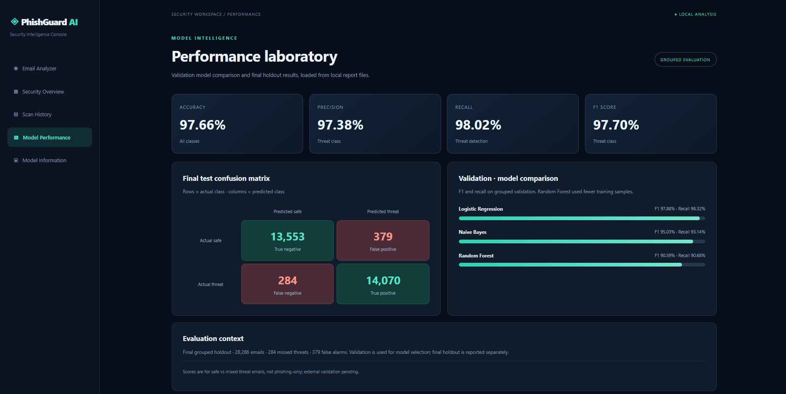
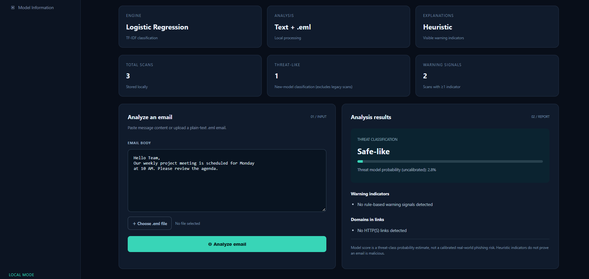
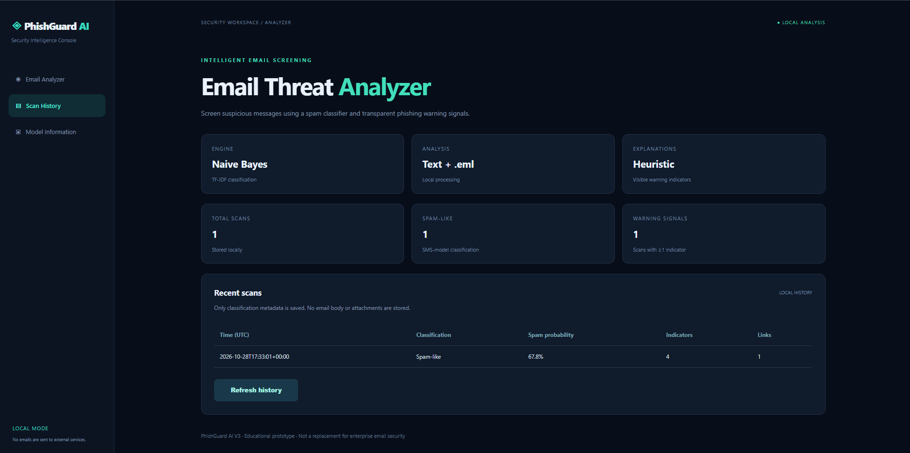
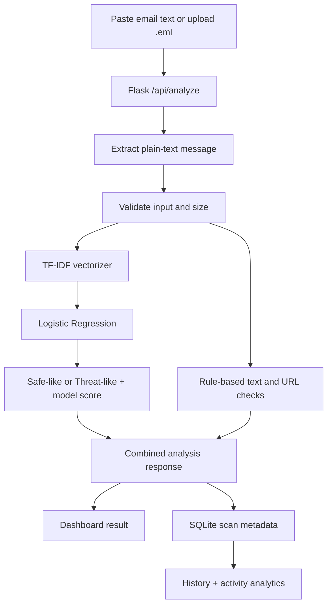

<div align="center">

# 🛡️ PhishGuard AI
### Intelligent Email Threat Detection & Security Analytics

**An end-to-end machine learning and Flask application for classifying email text as safe-like or threat-like, explaining warning indicators, and monitoring local scan activity.**

    

</div>

> **Scope:** This is a research/portfolio prototype, **not** a production email-security gateway. The dataset's positive class combines phishing, spam, and scam messages. Metrics below measure **safe vs. mixed-threat classification**, not phishing-only accuracy or real-world protection.

## 📸 Dashboard Preview



| Threat Analysis | Model Performance |
|---|---|
|  |  |

<details><summary>More screenshots</summary>

**Safe-like example**



**Scan history** (an earlier UI iteration; metadata structure remains representative)


</details>

## ✨ Key Features

- **Email analyzer:** paste a message or upload a plain-text `.eml` file (maximum request size: 256 KB; analyzed text up to 20,000 characters).
- **ML classification:** TF-IDF word unigram/bigram features with Logistic Regression; returns `Safe-like` or `Threat-like` and an **uncalibrated** threat-class probability.
- **Transparent indicators:** checks for credential requests, urgency, payment language, unencrypted HTTP URLs, IP-address links, and internationalized domains.
- **Security overview:** local scan counters, classification mix, and daily activity charts.
- **Model performance laboratory:** grouped validation comparison, holdout evaluation cards, and confusion matrix.
- **Scan history:** SQLite stores only timestamp, label, score, model version, and indicator/link counts — not email bodies or attachments.
- **Legacy-aware analytics:** dashboard charts distinguish the current email model from older SMS-model scans.

## 🧭 How It Works



**The model prediction and warning indicators are separate signals.** A low model score does not establish that an email is safe; warnings do not independently prove maliciousness. The application does not open extracted URLs or execute email attachments.

## 🧪 ML Training & Evaluation

The development process used a public, merged, labeled email corpus and the following protocol:

1. Load **198,450** labeled examples (initially balanced: 99,225 per class).
2. Remove blank entries, contradictory labels, and duplicate normalized message texts, leaving **192,550** examples (95,190 safe; 97,360 mixed threat).
3. Normalize URL/email/number tokens for **template-based grouping**; split by group to reduce repeated-template leakage.
4. Fit the TF-IDF vectorizer **only on training data**, inside each scikit-learn Pipeline.
5. Evaluate Naive Bayes, Logistic Regression, and Random Forest on grouped validation data; select Logistic Regression by validation F1.
6. Evaluate that selected model on the separately held-out grouped test set.

**Grouped split:** 134,381 training · 29,883 validation · 28,286 test. Normalized-template overlap was checked to be zero, but semantic and source-level leakage remain possible. Random Forest was trained on a balanced **40,000-record subset**, unlike the other two models.

### Grouped validation results

| Model | Accuracy | Threat precision | Threat recall | Threat F1 | Missed threats |
|---|---:|---:|---:|---:|---:|
| **Logistic Regression** | **97.84%** | **97.45%** | **98.32%** | **97.88%** | **255** |
| Naive Bayes | 95.04% | 97.00% | 93.14% | 95.03% | 1,043 |
| Random Forest* | 90.41% | 90.49% | 90.68% | 90.59% | 1,416 |

*Random Forest trained on a smaller, balanced sample; not a training-budget-matched comparison.*

### Final grouped holdout test — Logistic Regression

| Metric | Value |
|---|---:|
| Test messages | **28,286** |
| Accuracy | **97.66%** |
| Threat precision | **97.38%** |
| Threat recall | **98.02%** |
| Threat F1-score | **97.70%** |
| False positives | 379 |
| False negatives | 284 |

**Confusion matrix (rows = actual; columns = predicted):**

| | Predicted safe | Predicted threat |
|---|---:|---:|
| Actual safe | 13,553 | 379 |
| Actual threat | 284 | 14,070 |

These metrics are based on the local experiment outputs preserved in [`reports/grouped`](reports/grouped). The repository does not establish robustness against unseen providers, novel phishing campaigns, or adversarial text.

## 🏗️ Repository Structure

```text
.
├── app.py                         # Flask routes, API, SQLite metadata
├── detector.py                    # TF-IDF/LogReg inference + warning rules
├── templates/index.html           # Main dashboard
├── static/
│   ├── app.js                     # Frontend interactions and charts
│   └── style.css                  # Dark dashboard styling
├── reports/grouped/              # Validation + holdout metrics (JSON)
├── docs/screenshots/             # Project interface screenshots
├── requirements.txt
└── .gitignore
```

**Not tracked:** datasets, local SQLite history, virtual environments, secrets, and generated model binaries. Training scripts were developed separately; add your reviewed local `training/*.py` files if you want to make retraining reproducible.

## 🚀 Run Locally (Windows CMD)

```bat
# Clone the original repository
 git clone https://github.com/nusaikaj/Email-Fraud-Detection-System.git
 cd Email-Fraud-Detection-System

# Create and activate a virtual environment
 py -3.13 -m venv .venv
 .venv\Scripts\activate

# Install dependencies
 python -m pip install -r requirements.txt
```

**Required model artifact:** `detector.py` loads the locally trained, trusted pipeline from:

```text
models_v32_grouped/logistic_regression.joblib
```

The model is **not bundled** with this source-only repository package. Copy your own artifact from the validated local training run into that location; alternatively retrain with your local training scripts. Never download and unpickle arbitrary `.joblib` models from untrusted sources. Use **scikit-learn 1.8.0** for compatibility with the model evaluated here.

After provisioning the model:

```bat
python app.py
```

Open **http://127.0.0.1:5000**. The app binds to the loopback interface; its Flask development server is not intended for public deployment.

## 🔌 API Reference

| Method | Endpoint | Description |
|---|---|---|
| `GET` | `/` | Dashboard |
| `GET` | `/health` | Simple health response |
| `POST` | `/api/analyze` | Analyze JSON (`email`), form text, or `.eml` upload (`file`) |
| `GET` | `/api/history` | Recent 50 local scan metadata rows |
| `GET` | `/api/stats` | Aggregate scan statistics |
| `GET` | `/api/analytics` | Daily activity and V3.2-only breakdown |
| `GET` | `/api/model-metrics` | Local grouped validation and holdout JSON reports |

Example request:

```bash
curl -X POST http://127.0.0.1:5000/api/analyze \
  -H "Content-Type: application/json" \
  -d '{"email":"URGENT: Verify your password now."}'
```

Example response shape (illustrative; scores vary with the text and saved model):

```json
{
  "label": "Threat-like",
  "threat_probability": 0.9,
  "model_version": "v3.2-logistic-regression",
  "signals": ["Credential request", "Urgency or pressure"],
  "links_found": [],
  "disclaimer": "Model score is an estimate, not a verified phishing risk."
}
```

## 🔐 Responsible Use & Limitations

- **Mixed-class dataset:** label `1` includes phishing, spam, and scam; it does **not** isolate phishing attacks.
- **Evaluation constraints:** group-based isolation reduces simple template overlap but does not replace evaluation on a wholly external organization/source or time-based data.
- **Uncalibrated scores:** `predict_proba` is not a verified probability of harm; avoid promising safety or production-grade accuracy.
- **Local privacy:** raw email bodies and attachments are not persisted to SQLite. Use fabricated/redacted emails in public screenshots.
- **Threat indicators:** regex rules are interpretability aids, not authentication checks. SPF, DKIM, DMARC, malicious-URL reputation and attachment sandboxing are **not implemented**.
- **Deployment:** use locally for demos. Any internet-facing deployment requires authentication, CSRF protections where appropriate, operational logging controls, rate limiting, and production hosting/security review.
- **Artifact trust:** load only your own model artifacts; Python pickle/joblib formats may execute code when loading untrusted files.

## 🛣️ Potential Enhancements

External-source phishing-only evaluation, probability calibration, threshold/false-negative tradeoffs, `.eml` header authentication analysis, stronger URL reputation checks, safe batch inference, and packaging the model for reproducible deployment.

## 👨‍💻 Maintainer

[GitHub](https://github.com/nusaikaj) · [Portfolio](https://nusaik-portfolio.vercel.app/)

---

Built as an applied machine-learning and cybersecurity analytics portfolio project.
